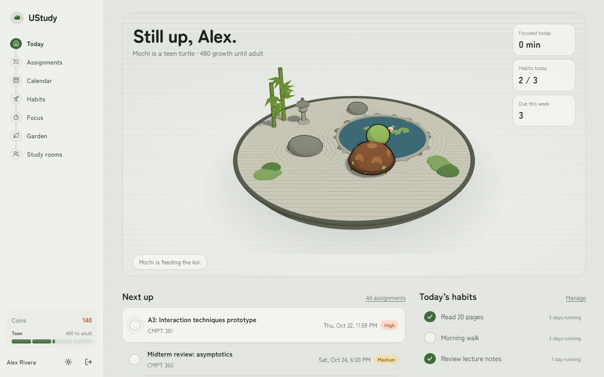
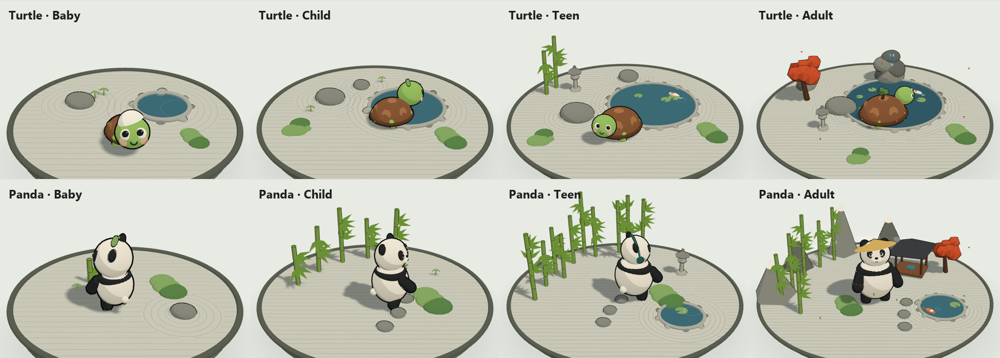
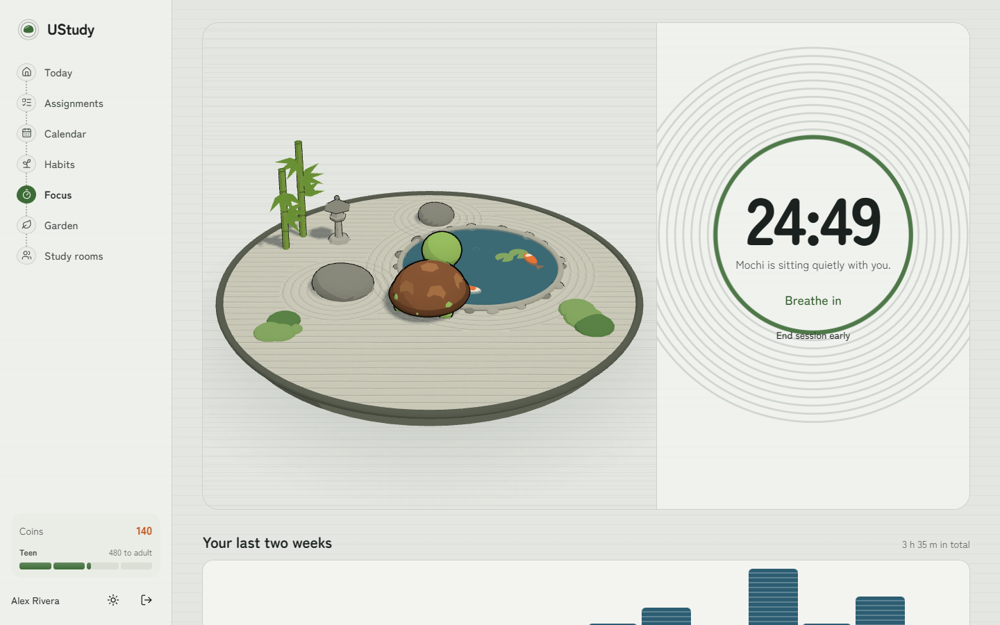
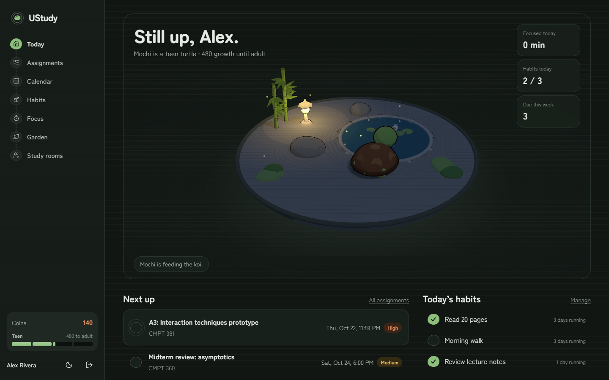
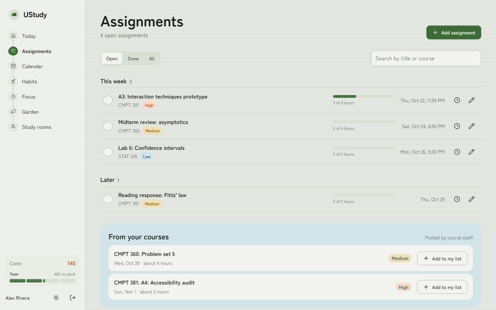
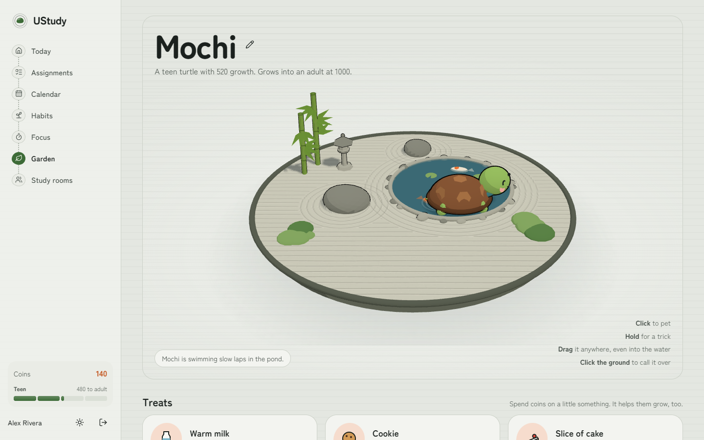
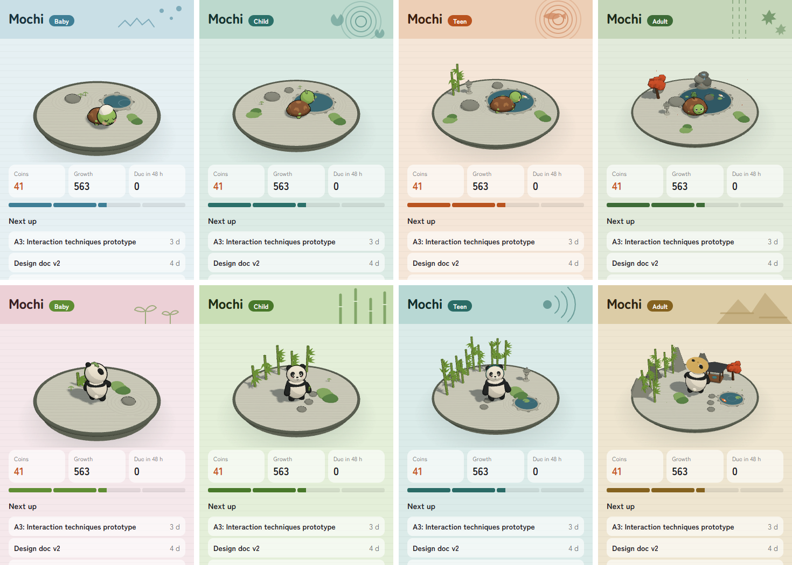
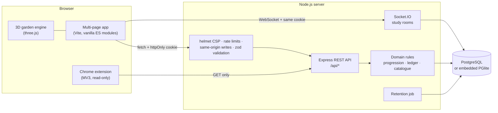
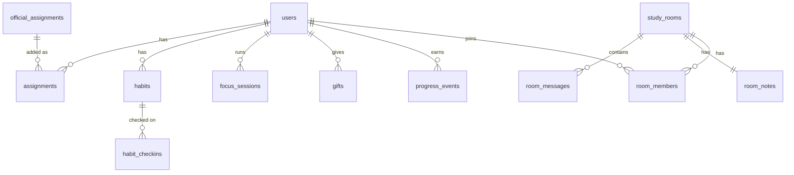

# UStudy

**A study companion that grows up with you.** Finish assignments, keep focus sessions and check off habits, and a turtle or panda grows from a wobbly baby into a calm adult in a 3D zen garden you build by studying.



UStudy is a full-stack web app with an Express/PostgreSQL backend, a realtime layer, a three.js frontend and a companion Chrome extension. Everything here runs locally: one `npm install` and it works, with no database to set up.

---

## What it does

| | |
|---|---|
| **Today** | The companion's garden, what's due next, today's habits and focus time, at a glance. |
| **Assignments** | Grouped by urgency, with hours logging, inline validation, and course assignments posted by staff. |
| **Calendar** | A month view with a colour per course and a day panel. |
| **Habits** | Weekly targets and a four-week check-in grid. |
| **Focus** | Server-timed sessions, raked ripple rings that fill as time passes, a breathing guide and a synthesised temple bell. |
| **Garden** | Pet, drag and feed your companion, track its growth across four life stages, and see where every point came from. |
| **Study rooms** | Host or join by code, with realtime chat, presence and shared notes over Socket.IO. |
| **Course admin** | Staff post assignments once; students add them to their own list. |
| **Chrome extension** | Your companion in the toolbar, with a skin per companion and life stage. |

## The companions

Two companions, four life stages each, each with its own garden that grows with it. They're built procedurally in three.js (no model files) and have real behaviour:

- **Turtle:** swims laps, basks on the warm stone and feeds the koi. As an adult, it carries a bonsai on its shell.
- **Panda:** munches bamboo and climbs the stalks (teen and up), naps on moss, and meditates in a tea pavilion as an adult.



**Interactions:**
- **Click** to pet.
- **Hold** for a trick: the turtle spins in its shell, the panda somersaults.
- **Drag** them anywhere. Dropped in the pond, the turtle swims off happily and the panda splashes and shakes itself dry.
- **Click the ground** to call them over.
- Their **eyes follow your cursor** anywhere on the page.
- **Treats** bought with coins are eaten on screen, with a different reaction for each treat and stage. The adult bows to say thank you.

At night (or in the night theme) the lanterns light up, fireflies come out and companions head to bed. With `prefers-reduced-motion`, the ambient animation stops.

<table>
<tr>
<td></td>
<td></td>
</tr>
<tr>
<td></td>
<td></td>
</tr>
</table>

### Chrome extension



Each companion and stage has its own popup skin (palette and header motif). The toolbar icon is a live render of your companion, and the badge counts what's due in the next 48 hours. The extension is **read-only** by design: it only issues `GET` requests and never spends coins or changes data.

---

## System design



**Key decisions:**

- **The server decides every reward.** Clients never send XP or coin amounts. Completing an assignment, finishing a focus session or checking off a habit triggers a rule in `server/domain/progression.js`, and every change is written to a `progress_events` ledger with a `UNIQUE (user, kind, ref)` key. Replays and double-clicks can't pay twice, and reopening and re-completing an assignment earns nothing extra.
- **Spending is atomic.** A purchase is a single `UPDATE … WHERE coins + delta >= 0` inside the gift's transaction, so five simultaneous purchases can't overspend (there's a test for exactly that).
- **Focus time is measured by the server.** The client says *start* and *finish*. The server credits `min(elapsed, planned)` minutes and caps focus XP per day, so a reloaded page resumes from the server's clock.
- **One database interface, two engines.** `server/db/index.js` exposes `query()` and `tx()` over node-postgres when `DATABASE_URL` is set, or over [PGlite](https://pglite.dev) (Postgres compiled to WebAssembly) otherwise. That gives zero-setup local runs, and every test gets a fresh in-memory Postgres.
- **Rooms are realtime but authenticated.** Sockets authenticate with the same httpOnly cookie as the REST API, and the author of every chat message comes from the session, never from the client.
- **Pages share one shell and one garden module.** Each page is a small ES module. The 3D garden is a self-contained package (`web/src/garden/`) that the site and the extension both use.

### Data model



Migrations live in `server/db/migrations/` and run in order at startup, tracked in a `schema_migrations` table.

### Progression

| Life stage | Growth needed | Earned by |
|---|---|---|
| Baby | 0 | Completing an assignment: 32–70 growth, 6–25 coins (scales with hours) |
| Child | 150 | Focus: 1 growth per minute, from 5 minutes, up to 240 a day |
| Teen | 450 | Habit check-in: 8 growth, 1 coin, once per habit per day |
| Adult | 1000 | Treats: milk 20, cookie 50, cake 100 coins, each adding some growth |

### Security

The app is a portfolio piece, so the security is part of the demo. Each item below is covered by a test in `tests/security.test.js` or the matching feature test.

- **Sessions:** a signed JWT in an `httpOnly`, `SameSite=Strict` cookie, never readable by page scripts. There is no fallback secret: the server refuses to start in production without `JWT_SECRET`.
- **Cross-site request forgery (CSRF):**
  - `SameSite=Strict` cookies;
  - state-changing requests from another origin are rejected;
  - no CORS headers are sent at all.
- **Content Security Policy:**
  - `script-src 'self'` and `style-src 'self'`;
  - no inline scripts or styles anywhere;
  - fonts are self-hosted and three.js is bundled, so there are no CDNs.
- **Input:** every body, parameter and query is validated with zod, and errors come back field by field. Bodies are capped at 64 kB.
- **Script injection (XSS):** user content is only ever inserted as text through a small DOM helper. The page code never uses `innerHTML` on user data.
- **Passwords:**
  - bcrypt with cost 12;
  - minimum length enforced;
  - unknown emails and wrong passwords get the same response and take the same time.
- **Abuse:**
  - rate limits on sign-in and writes;
  - per-socket message limits;
  - a cap on hosted rooms;
  - a daily focus-XP cap.
- **Errors:** unexpected errors return a generic 500. Internals and SQL never reach the client.
- **Authorization:** every query is scoped to the signed-in user, and admin routes require the admin role from the session (tested: one student can't read or edit another's data).
- **Exposure:** only the built frontend (`dist/`) is served. Server code can't be fetched over HTTP.
- **Retention:** expired study rooms and messages older than 14 days are purged on a schedule.

---

## Run it

Requires **Node.js 20.19+**.

```bash
npm install
npm run build      # builds the frontend into dist/
npm start          # http://localhost:3000
```

On first run it creates a local database in `.data/` and two **sample accounts** (sample data only):

| | Email | Password |
|---|---|---|
| Student | `demo@ustudy.app` | `study-with-mochi` |
| Course admin | `admin@ustudy.app` | `admin-garden-keeper` |

The sign-in page also has a **Use the sample account** button.

**Development** uses two terminals: `npm run dev` (the API, restarting on change) and `npm run dev:web` (Vite at http://localhost:5173, proxying `/api`).

**Configuration:** copy `.env.example` to `.env`. Everything is optional locally. Set `DATABASE_URL` to use your own PostgreSQL 14+ instead of the embedded database, and set `JWT_SECRET` in production.

**Chrome extension:** run `npm run build:extension`, open `chrome://extensions`, turn on Developer mode, choose **Load unpacked**, and select `extension/dist`. Then sign in to UStudy at `http://localhost:3000` in the same browser.

**Tests:** `npm test` runs 39 API, security and realtime tests against an in-memory Postgres.

## Project structure

```
server/
  app.js              Express app: security middleware and routes
  index.js            boot: config → migrate → seed → HTTP + Socket.IO
  config.js           validated environment config
  db/                 query/tx interface, migrations, sample data
  domain/             progression rules, reward ledger, treat catalogue
  middleware/         sessions, validation, same-origin writes, errors
  routes/             auth, assignments, official, habits, focus, companion, rooms
  realtime/           authenticated Socket.IO study rooms
  jobs/               retention
web/
  *.html              one entry per page
  src/garden/         the 3D garden: worlds, characters, behaviour, effects
  src/lib/            shell, API client, DOM helper, toasts, sheets, theme
  src/pages/          one module per page
  src/styles/         design tokens and page styles
extension/            Chrome extension (popup, skins, background badge)
tests/                node:test + supertest
```

## Design

The visual language is a Japanese dry garden:
- **Ground:** raked granite gravel.
- **Navigation:** a stepping-stone path.
- **Checkboxes:** pebbles.
- **Progress:** bamboo segments.
- **Focus timer:** ripple rings that rake outward.

Colour always carries meaning: moss for actions, pond indigo for information, koi orange for coins, lantern gold for growth. The type comes from the Zen family (Zen Maru Gothic and Zen Kaku Gothic New). Both a day and a night theme follow the system setting, and either can be chosen manually.

---

## Credits

UStudy began as a team project for CMPT 370 (Intermediate Software Engineering) at the University of Saskatchewan. This repository is a ground-up rebuild of that project: new architecture, backend, security model, interface and 3D companions.

Thanks to the original team for the idea and the first version, including the pixel-art turtle and panda that inspired the 3D companions: **Diefer Santos**, **Laaiba Shaikh** and **Jimin Park**.

Built by **Nguyen Ha Nhat Minh**.
